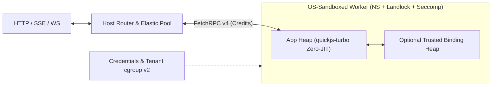

<div align="center">


### Process-isolated JavaScript at isolate density.

Run untrusted AI-generated code, customer plugins, and webhooks in **dedicated Linux OS sandboxes** — zero JIT, sub-20 MiB serving PSS, scale-to-zero elastic pools, and zero external storage dependencies.

<p>
  <a href="https://rowanellis-113.github.io/capsid/"></a>
  <a href="https://github.com/rowanellis-113/capsid/releases/tag/v0.3.2-beta.1"></a>
  <a href="docs/reference/embedding-api.md"></a>
  <a href="LICENSE"></a>
</p>

</div>

- **`19.3 MiB` loaded service PSS** (`Host + strict worker` @ 64 conn) — **28.8&times; lower** than `workerd` (`555.7 MiB`)
- **`705` warm OS workers in 2 GiB** (`10 KiB` app, 99.4% warm retention; `501` @ `100 KiB`, `135` @ `1 MiB`)
- **`8.89 ms` C ABI cold start** to first response (`10 KiB` trusted bytecode, `8.2 MiB` PSS; `9.29 ms` source)
- **`Zero-JIT` (`quickjs-turbo`)** — no RWX pages, fenced by Linux `namespaces` + `Landlock` + `seccomp` + `cgroup v2`
- **Dual-Runtime Trusted Bindings (`dev/v0.4.0`)** — run Host-trusted capability packages (DBs, SQLite, vaults, APIs) in isolated per-Binding QuickJS heaps with credit streams, HTTP proxies, and `RpcTarget` handles; zero overhead when unused

**[Explore interactive Multi-Axis &amp; Frontier charts &rarr;](https://rowanellis-113.github.io/capsid/)**

---

## Why Capsid

Running untrusted tenant or AI-generated JavaScript usually forces a trade-off: **V8 isolates** share one JIT process address space and balloon in memory under concurrent load, while **containers and microVMs** pay `100 ms – 1 s+` cold starts and tens to hundreds of MiB per tenant.

1. **Hard OS Isolation, Zero JIT** — Every worker runs in its own Linux process (`namespaces` + `Landlock` + `seccomp` + delegated `cgroup v2`), with deny-by-default egress, zero RWX JIT pages, and zero ambient credentials or filesystem access.
2. **Elastic OS Process Pools (`v0.3.2-beta.1`)** — Idle apps scale to zero (`0` processes, `0 B` worker RAM) while bounded cold queues absorb bursts. Two-stage tenant-fair eviction (`85% / 75%` hysteresis) reclaims over-share bursty replicas before touching quiet tenants and keeps active HTTP, SSE, and WebSocket streams exempt from idle eviction. Capacity slots hand off immediately while evicted worker processes exit asynchronously so Linux reclaims **100% of private physical pages**; rolling deployments drain live traffic up to `drain_deadline` under a shared delegated tenant `cgroup v2` `memory.max`.
3. **Dual-Runtime Trusted Bindings (`dev/v0.4.0`)** — Give untrusted code safe access to databases, SQLite, secrets, or internal APIs without leaking credentials or adding external sidecars. Host-installed `capsid/binding-v1` packages run in separate per-Binding QuickJS heaps inside the same OS-sandboxed worker; untrusted JS receives only asynchronous proxies (credit-backed Web Streams, controlled `Request`/`Response`, and `RpcTarget` handles) while real sockets, files, and `valueFrom` secrets remain strictly inside the Binding Runtime — with **zero cost** when no Binding is declared.
4. **Web-Native &amp; Embeddable, Zero External Dependencies** — Standard `fetch(Request)` and full-duplex WebSockets ([FetchRPC v4](docs/reference/fetchrpc-v4.md), inbound `WebSocketPair` + egress-gated outbound `ws`/`wss`) with no S3 coordinator or cloud state layer required. Run standalone via `capsid-host` for **AI Agent Code Mode**, **SaaS webhooks/plugins**, and **private on-prem functions**, or embed `libcapsid_runtime` directly into a C/C++ gateway.

| | V8 Isolates (`workerd`) | **Capsid** |
| :--- | :--- | :--- |
| **Isolation** | In-process V8 heap (JIT) | **OS process** (`NS`/`Landlock`/`seccomp`/`cgroup v2`, Zero-JIT) |
| **Loaded PSS (64c)** | `555.7 MiB` | **`19.3 MiB`** (28.8&times; lower) |
| **2 GiB warm density** | `572` cells (`10 KiB`) | **`705` OS workers** (`99.4%` retention) |
| **Cold start (10 KiB)** | `17.21 ms` / `57.9 MiB` | **`8.89 ms` / `8.2 MiB`** (C ABI trusted bytecode) |
| **Memory reclaim** | Shared process heap | **OS exit returns 100% private pages** |

> *(Containers and microVMs provide kernel isolation too, but typically pay `100 ms – 1 s+` cold starts and fit dozens of instances per 2 GiB rather than hundreds.)*

---

## Benchmarks

Single archived `capsid-perf-lane-v3` session (**4,533 replayable evidence files**, `exact-bytes-v2`, zero errors). Serving throughput uses medians of five 15 s rounds at 64 keep-alive connections:

| Stack | 1K JSON | Loaded PSS | 1K QPS / MiB |
| :--- | ---: | ---: | ---: |
| **Capsid** *(Strict Linux OS sandbox)* | **41,125** | **19.3 MiB** | **2,130.8** |
| workerd *(V8 Isolate)* | 26,121 | 555.7 MiB | 47.0 |
| Deno *(Permission sandbox)* | 143,244 | 63.4 MiB | 2,259.4 |
| Node `--jitless` *(No sandbox)* | 12,281 | 65.0 MiB | 188.9 |

Capsid outperforms `workerd` on **3 of 4 workloads** (**+57.4%** 1K JSON, **+20.2%** 16K JSON, **+2.3%** Dynamic API) at **45.3&times; higher QPS/MiB**, with **+23.3% more warm 10 KiB workers** in 2 GiB (`705` vs `572`). **[Interactive charts &amp; evidence downloads &rarr;](https://rowanellis-113.github.io/capsid/)**

<details>
<summary><strong>Full 7-stack tables, cold start, 2 GiB density &amp; measurement provenance</strong></summary>

<br />

#### Serving Throughput &amp; Memory (64 Keep-Alive Connections)

| Stack | Tier &amp; Isolation | JSON 1 KiB | JSON 16 KiB | Stream 1 KiB | Dynamic API | Trickle PSS | Loaded PSS | 1K QPS / MiB |
| :--- | :--- | ---: | ---: | ---: | ---: | ---: | ---: | ---: |
| **Capsid** | **T1 &middot; Strict Linux OS sandbox** | **41,125** | **23,202** | **14,675** | **19,512** | **16.1 MiB** | **19.3 MiB** | **2,130.8** |
| workerd | T1 &middot; V8 Isolate | 26,121 | 19,308 | 18,823 | 19,075 | 56.4 MiB | 555.7 MiB | 47.0 |
| Deno | T1 &middot; Permission sandbox (`--allow-net`) | 143,244 | 46,036 | 86,937 | 57,849 | 41.0 MiB | 63.4 MiB | 2,259.4 |
| Node `--jitless` | T2 &middot; No sandbox (V8 no-JIT) | 12,281 | 12,710 | 10,616 | 9,050 | 56.4 MiB | 65.0 MiB | 188.9 |
| Bun `--jitless` | T2 &middot; No sandbox (JSC no-JIT) | 142,484 | 44,622 | 127,275 | 44,037 | 34.3 MiB | 37.2 MiB | 3,830.2 |
| Node.js | T3 &middot; No sandbox (V8 JIT) | 110,011 | 44,059 | 85,716 | 54,640 | 60.6 MiB | 135.0 MiB | 814.9 |
| Bun | T3 &middot; No sandbox (JSC JIT) | 145,428 | 48,254 | 141,231 | 80,535 | 36.5 MiB | 47.5 MiB | 3,061.6 |

#### Cold Start Latency (Spawn to First Validated Response)

| Runtime | 10 KiB (ms / PSS) | 100 KiB (ms / PSS) | 1 MiB (ms / PSS) | Warm Request |
| :--- | ---: | ---: | ---: | ---: |
| **Capsid &middot; bytecode** | **8.89 ms / 8.2 MiB** | **10.22 ms / 8.9 MiB** | **21.43 ms / 14.7 MiB** | **0.071–0.076 ms** |
| **Capsid &middot; source** | **9.29 ms / 8.2 MiB** | **14.23 ms / 9.3 MiB** | **70.55 ms / 19.4 MiB** | **0.071–0.073 ms** |
| workerd | 17.21 ms / 57.9 MiB | 20.68 ms / 59.9 MiB | 38.45 ms / 73.0 MiB | 0.214–0.228 ms |
| Bun | 14.15 ms / 35.3 MiB | 13.98 ms / 36.9 MiB | 66.37 ms / 45.9 MiB | 0.110–0.114 ms |
| Deno | 30.04 ms / 38.0 MiB | 35.99 ms / 39.0 MiB | 114.36 ms / 46.0 MiB | 0.126–0.129 ms |
| Node.js | 48.76 ms / 60.7 MiB | 48.93 ms / 61.4 MiB | 69.66 ms / 76.4 MiB | 0.187–0.207 ms |

#### 2 GiB Multi-Tenant Density *(Budget-Limited, Host + Entire Worker Pool)*

| Stack | Phase | 10 KiB | 100 KiB | 1 MiB |
| :--- | :--- | ---: | ---: | ---: |
| **Capsid workers** *(Strict Linux OS sandbox)* | Cold (1 req) | **709** | **502** | **135** |
| **Capsid workers** *(Strict Linux OS sandbox)* | Warm (100 req) | **705** | **501** | **135** |
| workerd cells *(V8 Isolates)* | Cold (1 req) | 948 | 808 | 254 |
| workerd cells *(V8 Isolates)* | Warm (100 req) | 572 | 524 | 264 |

> **Measurement provenance &amp; honest trade-offs:** Local Release/LTO rebuild of untagged `dev/v0.3.2` commit `24671d9` (`quickjs-turbo v0.15.1-turbo.8`, 2026-11-27 UTC) on an i5-12400F under WSL2 with logical CPUs 0–3 — **not** a distributed release package. Capsid's `8.89 ms` cold-start path measures spawn-to-first-response over the C ABI (excluding Managed Host cold-queue waiting and optional delegated tenant `cgroup v2` attachment), whereas reference stacks use HTTP transport; do not read cold-start latency as an engine-only comparison. On unconstrained single-process peak throughput, JIT runtimes (`Bun`, `Deno`, `Node.js`) remain faster. [Full methodology](docs/reference/benchmarks.md) &middot; [Density spec](bench/SPEC.md) &middot; [Replay guide](perf-site/README.md#restore-and-independently-check-an-existing-point)

</details>

---

## Quick Start

Write standard Web `fetch(Request)` JavaScript — save `bundle.mjs` in an empty directory:

```js
export default {
  async fetch(request) {
    const event = await request.json();
    const queue = event.type === "incident.opened" ? "on-call" : "inbox";
    return Response.json({ queue });
  },
};
```

Launch with Config v2 (`dev/v0.3.2`, `capsid/app-v2`) and send an event:

```sh
printf '%s\n' '{"apiVersion":"capsid/app-v2"}' > capsid.json
capsid-host --app-dir . --listen 127.0.0.1:8080 --ready-fd 1

# Second terminal (after capsid-host-ready-v1)
curl -sS http://127.0.0.1:8080/ -H 'Content-Type: application/json' -d '{"type":"incident.opened"}'
# {"queue":"on-call"}
```

Add `"pool":{"minReady":0,"maxWorkers":8,"idleTimeout":"60s"}` in Linux managed mode for scale-to-zero elastic pools. **Hono**, **itty-router**, **H3**, and **Elysia** all run on Capsid ([framework matrix](docs/reference/frameworks/README.md)), alongside full-duplex inbound `WebSocketPair` and egress-gated outbound `ws`/`wss` ([WebSocket guide](docs/guides/use-websockets.md) &middot; [semantics](docs/reference/websocket-semantics.md)).

---

## Trusted Bindings (Dual-Runtime Capability Isolation)

Giving untrusted AI or tenant JavaScript access to databases, secrets, or internal services usually forces a bad choice: hand credentials/network egress directly to untrusted code, or push every call across an external sidecar over the network.

Capsid solves this **inside the same OS-sandboxed worker** with **Trusted Bindings** (`capsid/binding-v1` packages powered by **Binding RPC v2** on `dev/v0.4.0`):

- **Separate QuickJS heap per Binding, zero cost when unused:** Untrusted app JS runs in the **User Runtime**; each declared Host-trusted Binding runs in its own isolated **Binding Runtime** with separate heap, globals, module cache, and native origin tag. Workers with zero Bindings allocate no Binding heap, scheduler, or extra sandbox profile.
- **Process union &ne; User authority:** The Host approves each Binding's maximum modules and versioned Linux sandbox profiles (`network-client`, `filesystem-read/write`, `sqlite`, `wasi`); the App can only narrow resources and pass `valueFrom` secret references (automatically redacted from authenticated logs). Unforgeable native origin tags ensure a Binding's DB socket or write path is never reachable from User JS.
- **Web-native proxies only — real handles never cross:** User code interacts over a fair, 3-tier quota-bounded asynchronous bridge supporting `{ signal, timeoutMs }` cancellation, typed remote errors, bidirectional credit-based `ReadableStream`/`WritableStream` proxies, controlled `Request`/`Response` proxies (inline `<= 64 KiB` fast path + streaming bodies, immutable headers, `Request.signal`), and native-branded **`RpcTarget` remote object handles** (stateful sessions/cursors with bounded leases, explicit `.dispose()` / `Symbol.dispose`, GC-finalizer fallback, and strict cross-request ownership fencing).

**Create a Binding (`bindings/vault/manifest.json` + `index.js`)** — holds secrets &amp; granted `capsid:*` modules in its own heap:

```json
{
  "apiVersion": "capsid/binding-v1",
  "permissions": { "modules": ["capsid:hashing", "capsid:internal/core"] }
}
```

```js
import { createHash } from "capsid:hashing";

class Signer extends RpcTarget {
  constructor(key) { super({ leaseMs: 5000 }); this.key = key; }
  sign(text) { return createHash("sha256").update(`${this.key}:${text}`).digest(); }
}

export default ({ secrets }) => ({
  open() { return new Signer(secrets.signingKey); },
});
```

**Wire &amp; call it (`app/capsid.json` + `app/bundle.mjs`)** — untrusted JS never sees `signingKey` or native handles:

```json
{
  "apiVersion": "capsid/app-v2",
  "bindings": { "vault": { "secrets": { "signingKey": { "valueFrom": "signing-key" } } } }
}
```

```js
import vault from "capsid:binding/vault";

export default {
  async fetch(request) {
    const signer = await vault.open(null, { timeoutMs: 1000 });
    try {
      const sig = await signer.sign(await request.text());
      return Response.json({ sig });
    } finally {
      signer.dispose(); // deterministic cleanup (+ lease, request-end & GC fallback)
    }
  },
};
```

Run with `capsid-host --app-dir ./app --bindings-dir ./bindings --secrets-dir ./secrets`.

[Binding RPC v2 guide](docs/guides/use-binding-rpc-v2.md) &middot; [RPC v2 design](docs/design/binding-rpc-v2.md) &middot; [Binding v1 model](docs/design/bindings-v1.md) &middot; [Binding permissions](docs/reference/binding-permissions.md) &middot; [Full runnable example](examples/binding-rpc-v2/README.md)

### Install

> **Stable**: [`v0.2.2`](https://github.com/rowanellis-113/capsid/releases/tag/v0.2.2)
>
> **Prerelease**: [`v0.3.2-beta.1`](https://github.com/rowanellis-113/capsid/releases/tag/v0.3.2-beta.1) *(latest published prebuilt binaries — Config v2, Elastic OS Process Pools, C ABI v8 &amp; FetchRPC v4 &middot; [Windows packages](docs/guides/install-packages.md#install-on-windows))*

```sh
curl -fsSL https://github.com/rowanellis-113/capsid/releases/download/v0.3.2-beta.1/install.sh \
  | CAPSID_REPO=rowanellis-113/capsid bash -s -- v0.3.2-beta.1
```

<details>
<summary><strong>Build <code>dev/v0.4.0</code> from source (Binding RPC v2, Config v2, Elastic Pools &amp; C ABI v8)</strong></summary>

<br />

[Linux / macOS build guide](docs/guides/build-from-source.md) &middot; [Windows MSVC build guide](docs/guides/build-on-windows.md)

```sh
git clone --branch dev/v0.4.0 --recurse-submodules https://github.com/rowanellis-113/capsid.git
cd capsid && npm ci --ignore-scripts --prefix vendor/txiki.js
cmake -S . -B build-release -G Ninja -DCMAKE_BUILD_TYPE=Release -DCAPSID_BUILD_HOST=ON -DBUILD_TESTING=OFF
cmake --build build-release --parallel
cmake --install build-release --prefix "$HOME/opt/capsid-sdk"
export PATH="$HOME/opt/capsid-sdk/bin:$PATH"
```

</details>

---

## Embed the C/C++ SDK (ABI v8)

The v0.4.0 development SDK uses C ABI v8 (matching published `v0.3.2-beta.1`). Embed `libcapsid_runtime` via `<capsid/runtime.h>` (C11) or `<capsid/runtime.hpp>` (C++11 RAII) and register `capsid_worker_fd()` with your POSIX event loop:

```cpp
#include <capsid/runtime.hpp>

capsid::CapabilityPolicyBuilder policy;
policy.application_identity("tenant-a/webhook").allow_module("capsid:uuid");

capsid_worker_config config;
capsid_worker_config_init(&config);
config.worker_path = "/usr/local/bin/capsid-worker";
config.strict_sandbox = 1; // Linux: rlimits + no_new_privs + Landlock + seccomp
config.capability_policy = &policy.descriptor(); // egress_policy == NULL -> deny-all

capsid::Worker worker(config);
```

---

## Security &amp; Architecture

Capsid enforces **deny-by-default egress**, **explicit per-module grants**, and **fail-closed Linux strict sandboxing** — keeping credentials and authority strictly in the Host.

<details>
<summary><strong>Security contract &amp; 12 built-in modules</strong></summary>

<br />

- **Linux strict mode (opt-in in C API):** `strict_sandbox` is off by default in the C API. For untrusted applications, enable Linux strict mode and verify that `CAPSID_EVENT_READY.flags` contains the sandbox features required by the deployment.
- **Egress deny-by-default:** When `egress_policy == NULL`, all egress Fetch requests are denied.
- **No legacy `tjs:*` exposure:** `tjs:*` modules cannot be enabled through configuration.
- **Boundaries:** Load only trusted bytecode compiled for the matching worker build. macOS and Windows support trusted development.
- **Resource &amp; Policy modules:** `capsid:env`, `capsid:fs`, `capsid:stdio`, `capsid:storage`, `capsid:system`, `capsid:permissions`
- **Utility modules:** `capsid:assert`, `capsid:getopts`, `capsid:hashing`, `capsid:ipaddr`, `capsid:utils`, `capsid:uuid`

[Linux sandbox](docs/reference/linux-sandbox.md) &middot; [Capability policy](docs/reference/capability-policy.md) &middot; [Module permissions](docs/reference/module-permissions.md) &middot; [Security policy](SECURITY.md)

</details>

<details>
<summary><strong>Architecture overview</strong></summary>

<br />



- **Lazy property inline caches** — Purges startup inline caches before `READY` so idle workers stay compact (`src/worker_main.cc`, `src/worker_runtime.cc`).
- **Credit-based IPC backpressure** — Explicit byte credits on [FetchRPC v4](docs/reference/fetchrpc-v4.md) protect Host–worker buffers across HTTP, SSE, and [WebSockets](docs/guides/use-websockets.md).
- **Zero-cost Trusted Bindings (RPC v2)** — Credentials, credit-based streams, `Request`/`Response` proxies, and `RpcTarget` handles run in isolated per-Binding heaps only when declared ([Binding RPC v2](docs/design/binding-rpc-v2.md) &middot; [Binding v1](docs/design/bindings-v1.md)).
- **Scale-to-zero &amp; tenant `memory.max`** — Delegated Linux `cgroup v2` parent ceilings cover sibling apps and overlapping blue-green rollouts ([Config v2](docs/design/config-v2.md)).

</details>

---

## Documentation

- **Get Started:** [Docs index](docs/README.md) &middot; [Run an app](docs/guides/run-application.md) &middot; [Install packages](docs/guides/install-packages.md) &middot; [Build from source](docs/guides/build-from-source.md)
- **Bindings &amp; WebSockets:** [Use Binding RPC v2](docs/guides/use-binding-rpc-v2.md) &middot; [Binding RPC v2 example](examples/binding-rpc-v2/README.md) &middot; [Use WebSockets](docs/guides/use-websockets.md) &middot; [WebSocket example](examples/websocket-showcase/README.md)
- **Architecture &amp; Scaling:** [Config v2 &amp; elastic pools](docs/design/config-v2.md) &middot; [Binding RPC v2 design](docs/design/binding-rpc-v2.md) &middot; [Runtime](docs/design/runtime-architecture.md) &middot; [Host](docs/design/host-architecture.md) &middot; [Platform support](docs/reference/platform-support.md)
- **Embed &amp; Protocol:** [C/C++ API (ABI v8)](docs/reference/embedding-api.md) &middot; [FetchRPC v4](docs/reference/fetchrpc-v4.md) &middot; [WebSocket semantics](docs/reference/websocket-semantics.md) &middot; [Binding permissions](docs/reference/binding-permissions.md) &middot; [Host config](docs/reference/host-configuration.md)
- **Benchmarks &amp; Roadmap:** [Benchmarks](docs/reference/benchmarks.md) &middot; [Frameworks](docs/reference/frameworks/README.md) &middot; [Web conformance](docs/reference/web-conformance.md) &middot; [Release status](docs/reference/release-status.md) &middot; [Roadmap](ROADMAP.md)

<div align="center">
  <a href="CONTRIBUTING.md">Contributing</a> &nbsp;&middot;&nbsp;
  <a href="SECURITY.md">Security Policy</a> &nbsp;&middot;&nbsp;
  <a href="docs/history/v0.3.2/README.md">v0.3.2 Review Status</a> &nbsp;&middot;&nbsp;
  <a href="LICENSE">Apache-2.0 License</a>
</div>
