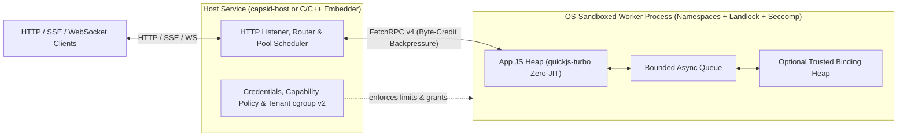

<div align="center">


### Process-isolated JavaScript at isolate density.

Run untrusted customer extensions, webhook rules, and AI-generated JavaScript in dedicated **OS-sandboxed worker processes** — using standard Web `fetch(Request)` handlers, sub-10 ms cold starts, and a zero-JIT footprint engineered for high-density multi-tenancy.

<p>
  <a href="https://github.com/rowanellis-113/capsid/releases/tag/v0.2.2"></a>
  <a href="https://github.com/rowanellis-113/capsid/releases/tag/v0.3.1-beta.1"></a>
  <a href="docs/reference/embedding-api.md"></a>
  <a href="docs/reference/benchmarks.md"></a>
  <a href="https://rowanellis-113.github.io/capsid/"></a>
  <a href="LICENSE"></a>
</p>

<p>
  <a href="#60-second-quick-start"><strong>Quick Start</strong></a> &nbsp;&middot;&nbsp;
  <a href="#benchmarks-and-replayable-evidence"><strong>Benchmarks</strong></a> &nbsp;&middot;&nbsp;
  <a href="#architecture"><strong>Architecture</strong></a> &nbsp;&middot;&nbsp;
  <a href="#install-and-embed-the-sdk"><strong>Install &amp; SDK</strong></a> &nbsp;&middot;&nbsp;
  <a href="#security-defaults-and-module-grants"><strong>Security</strong></a> &nbsp;&middot;&nbsp;
  <a href="docs/README.md"><strong>Docs</strong></a>
</p>

<br />

<table>
  <tr>
    <td align="center" width="25%">
      <br />
      <strong><code>705</code></strong><br />
      <sub><strong>Warm OS Workers in 2 GiB</strong><br />10 KiB app &middot; Linux strict sandbox</sub>
      <br /><br />
    </td>
    <td align="center" width="25%">
      <br />
      <strong><code>8.88 ms</code></strong><br />
      <sub><strong>Cold Start to First Response</strong><br />7.4 MiB PSS &middot; trusted bytecode</sub>
      <br /><br />
    </td>
    <td align="center" width="25%">
      <br />
      <strong><code>19.8 MiB</code></strong><br />
      <sub><strong>Loaded Service PSS</strong><br />Host + worker @ 64 conn (27.5&times; vs workerd)</sub>
      <br /><br />
    </td>
    <td align="center" width="25%">
      <br />
      <strong><code>Zero-JIT</code></strong><br />
      <sub><strong><code>quickjs-turbo</code> Native VM</strong><br />135 warm 1 MiB workers &middot; no RWX pages</sub>
      <br /><br />
    </td>
  </tr>
</table>

</div>

---

## Why Capsid

Running untrusted tenant or AI-generated JavaScript usually forces an uncomfortable trade-off: **V8 isolates** share a process address space and balloon in memory under concurrent load, while **containers and microVMs** deliver OS isolation at tens to hundreds of megabytes per tenant.

**Capsid eliminates that compromise.** Every worker is a real Linux-sandboxed OS process (`namespaces` + `Landlock` + `seccomp` + `cgroup v2`), yet hundreds of warm workers fit inside a single 2 GiB host. Ship Capsid standalone via `capsid-host`, or embed `libcapsid_runtime` directly into your C/C++ service so your control plane owns the listener, holds every credential, and enforces hard deadlines.

| Dimension | V8 Isolates (e.g. `workerd`) | Containers / MicroVMs | **Capsid** |
| :--- | :--- | :--- | :--- |
| **Isolation boundary** | In-process VM heap | OS / VM kernel boundary | **Dedicated OS process** (`NS` + `Landlock` + `seccomp` + `cgroup v2`) |
| **Memory under load** | High (`544.0 MiB` loaded PSS @ 64 conn) | Tens to hundreds of MiB per tenant | **`19.8 MiB` loaded PSS** (`Host + worker`, 27.5&times; lower) |
| **2 GiB warm density** | `571` cells (10 KiB app) | Dozens | **`705` warm OS workers** (10 KiB app; `500` @ 100 KiB, `135` @ 1 MiB) |
| **Cold start (10 KiB)** | `17.44 ms` / `58.8 MiB` | `100 ms – 1 s+` | **`8.88 ms` / `7.4 MiB`** (bytecode) &middot; `9.87 ms` (source) |
| **JIT / RWX attack surface** | Active JIT compiler | Runtime-dependent | **Zero-JIT** (`quickjs-turbo` native register-frame VM) |
| **Deployment model** | Standalone server | Orchestrated fleet | **Standalone Linux Host** or **Embeddable C/C++ SDK (ABI v8)** |

### Built for

- **AI Agents & Generated Code Execution** — Execute LLM-generated handlers and tool hooks behind hard kernel syscall filters, deny-by-default egress, and millisecond-scale teardown.
- **Customer Webhooks & SaaS Extensibility** — Let tenants deploy standard Web `fetch(Request)` rules without risking cross-tenant memory leaks or credential exposure.
- **High-Density Multi-Tenant Functions** — Pack hundreds of warm apps per GiB with scale-to-zero and tenant-wide Linux `cgroup v2` `memory.max` enforcement.
- **Embeddable C/C++ Gateways & Control Planes** — Drop `libcapsid_runtime` straight into an existing POSIX event loop (`epoll`/`kqueue`) with a frozen C11 / C++11 RAII ABI.

---

## 60-Second Quick Start

Write standard Web `fetch(Request)` JavaScript — no proprietary handler wrapper required. With `capsid-host` and `capsid-worker` from a `dev/v0.3.2` build on your `PATH`, save this webhook rule as `bundle.mjs` in an empty directory:

```js
export default {
  async fetch(request) {
    const event = await request.json();
    const queue = event.type === "incident.opened" ? "on-call" : "inbox";
    return Response.json({ queue });
  },
};
```

Create a minimal Config v2 manifest and start the local Host on loopback:

```sh
printf '%s\n' '{"apiVersion":"capsid/app-v2"}' > capsid.json
capsid-host --app-dir . --listen 127.0.0.1:8080 --ready-fd 1
```

Once the Host emits its `capsid-host-ready-v1` readiness line, send an event from a second terminal:

```sh
curl -sS http://127.0.0.1:8080/ \
  -H 'Content-Type: application/json' \
  -d '{"type":"incident.opened"}'
# {"queue":"on-call"}
```

> [!TIP]
> **Bring your favorite Web framework.** **Hono**, **itty-router**, **H3**, and **Elysia** all run against pinned compatibility suites on Capsid's `CAPSID-MIN-2025-subset-v0` Web API profile.
> [Framework compatibility matrix](docs/reference/frameworks/README.md) &middot; [Web API conformance](docs/reference/web-conformance.md) &middot; [Native Windows quick start](docs/guides/run-application.md#run-the-development-branch) &middot; [Run the published `v0.3.1-beta.1` CLI](docs/guides/run-application.md#run-the-published-beta)

---

## Benchmarks and Replayable Evidence

Every metric below comes from a single archived `capsid-perf-lane-v3` session containing **4,533 replayable evidence files** with byte-for-byte response verification (`exact-bytes-v2`, zero errors/timeouts/mismatches). **[Explore interactive charts &rarr;](https://rowanellis-113.github.io/capsid/)**

### Serving Throughput & Memory Efficiency (64 Keep-Alive Connections)

Medians of five 15-second measured rounds with 64 in-flight requests. `Dynamic API` parses a URL, reads headers, crosses an `async` boundary, builds and FNV-1a checksums an 8-item order, and serializes JSON per request.

| Stack | Tier &amp; Isolation | JSON 1 KiB | JSON 16 KiB | Stream 1 KiB | Dynamic API | Trickle PSS | Loaded PSS | 1K QPS / MiB |
| :--- | :--- | ---: | ---: | ---: | ---: | ---: | ---: | ---: |
| **Capsid** | **T1 &middot; Strict Linux OS sandbox** | **39,802** | **23,154** | **14,264** | **20,381** | **15.8 MiB** | **19.8 MiB** | **2,010.2** |
| workerd | T1 &middot; V8 Isolate | 26,006 | 19,772 | 19,674 | 19,282 | 56.4 MiB | 544.0 MiB | 47.8 |
| Deno | T1 &middot; Permission sandbox (`--allow-net`) | 144,741 | 47,081 | 85,488 | 56,479 | 40.8 MiB | 63.3 MiB | 2,286.6 |
| Node `--jitless` | T2 &middot; No sandbox (V8 no-JIT) | 12,132 | 12,342 | 10,637 | 8,858 | 77.6 MiB | 86.4 MiB | 140.4 |
| Bun `--jitless` | T2 &middot; No sandbox (JSC no-JIT) | 139,680 | 44,448 | 124,094 | 41,800 | 25.3 MiB | 28.2 MiB | 4,953.2 |
| Node.js | T3 &middot; No sandbox (V8 JIT) | 111,184 | 42,789 | 89,322 | 52,799 | 80.9 MiB | 153.6 MiB | 723.9 |
| Bun | T3 &middot; No sandbox (JSC JIT) | 142,294 | 44,785 | 134,532 | 77,000 | 27.6 MiB | 38.3 MiB | 3,715.2 |

- **27.5&times; lower loaded PSS** (`19.8 MiB` vs `544.0 MiB`) and **42.0&times; higher 1K QPS/MiB** (`2,010.2` vs `47.8`) than `workerd` under the same 64-connection load, while **outperforming `workerd` on 3 of 4 workloads** (**+53.0%** on JSON 1 KiB `39,802` vs `26,006`, **+17.1%** on JSON 16 KiB `23,154` vs `19,772`, and **+5.7%** on `Dynamic API` `20,381` vs `19,282 req/s`).
- **3.28&times; faster than `Node --jitless`** on 1 KiB JSON (`39,802` vs `12,132 req/s`) and **2.30&times; faster on `Dynamic API`** (`20,381` vs `8,858 req/s`) in **4.36&times; less memory**, while running inside a strict Linux OS sandbox.
- **2.08&times; higher `Dynamic API` throughput** (`20,381` vs `9,808 req/s`) and **+83.0% higher JSON 1 KiB throughput** (`39,802` vs `21,747 req/s`) than the earlier `c7a80b9` QuickJS-NG session, alongside **135 warm 1 MiB workers** (`13.8 MiB` cold bytecode PSS) on `dev/v0.3.2`.

### Cold Start Latency (Spawn to First Validated Response)

| Runtime | 10 KiB (ms / PSS) | 100 KiB (ms / PSS) | 1 MiB (ms / PSS) | Warm Request |
| :--- | ---: | ---: | ---: | ---: |
| **Capsid &middot; bytecode** | **8.88 ms / 7.4 MiB** | **10.15 ms / 8.0 MiB** | **20.22 ms / 13.8 MiB** | **0.071–0.074 ms** |
| **Capsid &middot; source** | **9.87 ms / 7.4 MiB** | **14.84 ms / 8.4 MiB** | **75.20 ms / 18.5 MiB** | **0.076–0.077 ms** |
| workerd | 17.44 ms / 58.8 MiB | 21.05 ms / 60.5 MiB | 43.41 ms / 73.9 MiB | 0.204–0.234 ms |
| Bun | 13.79 ms / 26.2 MiB | 14.78 ms / 27.8 MiB | 60.47 ms / 36.8 MiB | 0.107–0.112 ms |
| Deno | 71.62 ms / 39.5 MiB | 76.10 ms / 40.4 MiB | 153.56 ms / 47.9 MiB | 0.114–0.123 ms |
| Node.js | 43.15 ms / 81.0 MiB | 48.25 ms / 81.5 MiB | 69.57 ms / 96.7 MiB | 0.177–0.187 ms |

### 2 GiB Multi-Tenant Density *(Budget-Limited, Host + Entire Worker Pool)*

| Stack | Phase | 10 KiB App | 100 KiB App | 1 MiB App |
| :--- | :--- | ---: | ---: | ---: |
| **Capsid workers** *(Linux strict OS sandbox)* | Cold (1 req) | **709** | **502** | **135** |
| **Capsid workers** *(Linux strict OS sandbox)* | Warm (100 req) | **705** | **500** | **135** |
| workerd cells *(V8 Isolates)* | Cold (1 req) | 947 | 809 | 251 |
| workerd cells *(V8 Isolates)* | Warm (100 req) | 571 | 525 | 264 |

Capsid retains **99.4%–100%** of its cold count after 100 warm requests per worker — fitting **+23.5% more warm 10 KiB workers** inside 2 GiB than `workerd`, each in its own strict Linux OS sandbox.

> [!NOTE]
> **Measurement provenance &amp; honest trade-offs:** These are measurements of a **local Release/LTO rebuild** of the untagged `dev/v0.3.2` commit `d0adc21` (`quickjs-turbo v0.15.1-turbo.8`, 2026-11-24 UTC), on an i5-12400F under WSL2 with logical CPUs 0–3 assigned — **not** measurements of any distributed release package. Capsid's cold-start lane measures spawn-to-first-response over the C ABI (excluding the probe), whereas reference stacks use HTTP transport, so do not read cold-start times as an engine-only comparison. On raw single-process peak throughput without memory/sandbox constraints, JIT runtimes (`Bun`, `Deno`, `Node.js`) remain faster; Capsid optimizes for **process isolation per tenant, predictable PSS, and zero-JIT density**.
> [Full seven-stack results &amp; methodology](docs/reference/benchmarks.md) &middot; [Density protocol](bench/SPEC.md) &middot; [Replay the archived measurements](perf-site/README.md#restore-and-independently-check-an-existing-point)

---

## Architecture



| Subsystem | How it works | Reference |
| :--- | :--- | :--- |
| **Lazy property inline caches** | `quickjs-turbo` runs a zero-JIT bytecode interpreter. Capsid purges property lookup caches built during module initialization before the worker reports `READY`; hot request paths re-warm naturally without bloating idle worker memory. | [`src/worker_main.cc`](src/worker_main.cc) &middot; [`src/worker_runtime.cc`](src/worker_runtime.cc) |
| **Credit-based IPC backpressure** | FetchRPC places explicit byte credits on the Host&ndash;worker boundary so slow consumers never exhaust IPC buffers. Hosts can request duplex channels and WebSocket upgrades through v4 capability negotiation. | [Embedding API](docs/reference/embedding-api.md) &middot; [FetchRPC v4](docs/reference/fetchrpc-v4.md) |
| **Zero-cost Trusted Bindings** | Credentials and native handles stay outside untrusted JS. A Trusted Binding runs in its own isolated JS heap inside the worker behind an explicitly granted async method and bounded queue. Workers with zero Bindings allocate no Binding heap. | [Binding v1 architecture](docs/design/bindings-v1.md) |
| **Scale-to-zero &amp; tenant `memory.max`** | On **`dev/v0.3.2`**, idle apps scale to zero. Under Linux delegated `cgroup v2`, one tenant's `memory.max` covers sibling apps and overlapping rolling generations (e.g., an open SSE stream pinning the old generation while the new generation starts, both sharing the same 384 MiB ceiling in the rollout test). | [Config v2 design](docs/design/config-v2.md) &middot; [v0.3.2 review &amp; release gates](docs/history/v0.3.2/README.md) |

---

## Install and Embed the SDK

> **Stable**: [`v0.2.2`](https://github.com/rowanellis-113/capsid/releases/tag/v0.2.2)
>
> **Prerelease**: [`v0.3.1-beta.1`](https://github.com/rowanellis-113/capsid/releases/tag/v0.3.1-beta.1)

### Install the Published Beta (Linux / macOS)

That release ships the `single-worker` local CLI. [Run the published beta](docs/guides/run-application.md#run-the-published-beta) &middot; [Windows packages and checksums](docs/guides/install-packages.md#install-on-windows) &middot; [Build `dev/v0.3.2` from source](docs/guides/build-from-source.md)

```sh
curl -fsSL https://github.com/rowanellis-113/capsid/releases/download/v0.3.1-beta.1/install.sh \
  | CAPSID_REPO=rowanellis-113/capsid bash -s -- v0.3.1-beta.1
```

### Embed `libcapsid_runtime` in C or C++

The v0.3.2 development SDK uses C ABI v8. Embed `libcapsid_runtime` through `<capsid/runtime.h>` (C11) or `<capsid/runtime.hpp>` (C++11 RAII). On POSIX, register `capsid_worker_fd()` with your event loop and drain `capsid_worker_next_event()` as events arrive.

```cpp
#include <capsid/runtime.hpp>

capsid::CapabilityPolicyBuilder policy;
policy.application_identity("tenant-a/webhook")
      .allow_module("capsid:uuid");

capsid_worker_config config;
capsid_worker_config_init(&config);
config.worker_path = "/usr/local/bin/capsid-worker";
config.strict_sandbox = 1; // Linux strict baseline: rlimits + no_new_privs + Landlock + seccomp
config.capability_policy = &policy.descriptor(); // egress_policy == NULL -> deny-all

capsid::Worker worker(config);
// Load a bundle, poll worker.fd() in your reactor, drain capsid_worker_next_event(),
// and verify CAPSID_EVENT_READY.flags before dispatching requests.
```

Install the SDK headers, library, and binaries from a prepared Release build:

```sh
cmake --install build-release --prefix "$HOME/opt/capsid-sdk"
```

---

## Security Defaults and Module Grants

Capsid enforces **deny-by-default egress**, **explicit per-module grants**, and **fail-closed Linux strict sandboxing** — never trusting application JavaScript with ambient filesystem, network, or host credentials.

<details open>
<summary><strong>Sandbox contract, egress policy, and complete module inventory (12 built-in modules)</strong></summary>

<br />

- **Linux strict mode (opt-in in C API):** `strict_sandbox` is off by default in the C API. For untrusted applications, enable Linux strict mode and verify that `CAPSID_EVENT_READY.flags` contains the sandbox features required by the deployment. The strict baseline applies resource limits, `no_new_privs`, Landlock filesystem rules and a seccomp syscall allowlist.
- **Egress deny-by-default:** When `egress_policy == NULL`, all egress Fetch requests are denied.
- **No legacy `tjs:*` exposure:** `tjs:*` modules cannot be enabled through configuration.
- **Platform &amp; bytecode boundaries:** The published beta accepts `pidsMax` in application configuration but provides no per-application PID ceiling. Load only trusted bytecode compiled for the matching worker build. macOS and Windows support trusted development.

| Category | Built-in modules (explicitly granted by Host) |
| :--- | :--- |
| **Resource &amp; Policy** | `capsid:env`, `capsid:fs`, `capsid:stdio`, `capsid:storage`, `capsid:system`, `capsid:permissions` |
| **Utilities** | `capsid:assert`, `capsid:getopts`, `capsid:hashing`, `capsid:ipaddr`, `capsid:utils`, `capsid:uuid` |

[Linux sandbox contract](docs/reference/linux-sandbox.md) &middot; [Host capability policy](docs/reference/capability-policy.md) &middot; [Module permissions](docs/reference/module-permissions.md) &middot; [Security policy](SECURITY.md)

</details>

---

## Documentation

| Area | Guides &amp; Specifications |
| :--- | :--- |
| **Get Started** | [Documentation index](docs/README.md) &middot; [Run an application](docs/guides/run-application.md) &middot; [Install packages](docs/guides/install-packages.md) &middot; [Build from source](docs/guides/build-from-source.md) |
| **Embed &amp; Protocol** | [C &amp; C++ embedding API](docs/reference/embedding-api.md) &middot; [FetchRPC v4](docs/reference/fetchrpc-v4.md) &middot; [Trusted Bindings v1](docs/design/bindings-v1.md) &middot; [Host configuration](docs/reference/host-configuration.md) |
| **Architecture &amp; Scaling** | [Runtime architecture](docs/design/runtime-architecture.md) &middot; [Host architecture](docs/design/host-architecture.md) &middot; [Config v2 &amp; elastic pools](docs/design/config-v2.md) &middot; [Platform support](docs/reference/platform-support.md) |
| **Compatibility &amp; Benchmarks** | [Benchmarks](docs/reference/benchmarks.md) &middot; [Framework matrix](docs/reference/frameworks/README.md) &middot; [Web API conformance](docs/reference/web-conformance.md) &middot; [Release status](docs/reference/release-status.md) |

---

<div align="center">
  <a href="CONTRIBUTING.md">Contributing</a> &nbsp;&middot;&nbsp;
  <a href="SECURITY.md">Security Policy</a> &nbsp;&middot;&nbsp;
  <a href="docs/history/v0.3.2/README.md">v0.3.2 Review Status</a> &nbsp;&middot;&nbsp;
  <a href="LICENSE">Apache-2.0 License</a>
</div>
